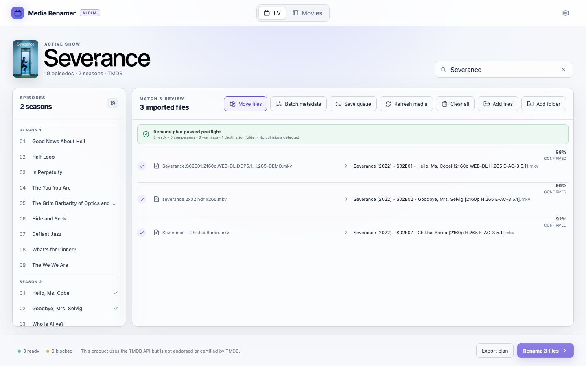

# Install or run Media Renamer

Media Renamer is free, open-source software. Windows and macOS releases are currently **unsigned**, so those operating systems may show an unfamiliar-publisher warning even when the download is genuine. Download only from the [official GitHub Releases page](https://github.com/manix84/media-renamer/releases) and verify the checksum before continuing.

## Contents

- [Install Media Renamer](#install-media-renamer)
  - [Windows installer](#windows-installer)
  - [macOS installer](#macos-installer)
  - [Linux installation](#linux-installation)
  - [Verify a download](#verify-a-download)
- [What the app looks like](#what-the-app-looks-like)
- [Portable Media Renamer](#portable-media-renamer)
  - [Windows portable](#windows-portable)
  - [macOS portable](#macos-portable)
  - [Linux portable](#linux-portable)
  - [Portable data and credentials](#portable-data-and-credentials)

---

# Install Media Renamer

Choose this section when you want Media Renamer integrated with the computer. Installed editions keep preferences, history, caches, and extensions in your operating-system user profile.

> **Install and Portable are different downloads.** Installers belong in this section. If you want the app and its data to travel together on a removable drive, skip to [Portable Media Renamer](#portable-media-renamer).

## Windows installer

Download the file ending in **`win-x64-unsigned-installer.msi`**.

1. Double-click the MSI and follow Windows Installer.
2. Because the MSI is unsigned, Microsoft Defender SmartScreen may show **Windows protected your PC** or Windows may identify the publisher as unknown.
3. After verifying the download, choose **More info → Run anyway** if SmartScreen appears.
4. Open **Media Renamer** from the Start menu.

The word `unsigned` in the filename is intentional. It means the installer does not carry a paid Microsoft-trusted publisher certificate; it does not mean the download failed verification.

## macOS installer

Download the file ending in **`mac-arm64-unsigned-installer.dmg`** on Apple silicon, or **`mac-x64-unsigned-installer.dmg`** on an Intel Mac.

1. Open the DMG and drag **Media Renamer** into **Applications**.
2. Try to open Media Renamer once. macOS may say it cannot verify the developer.
3. Open **System Settings → Privacy & Security**.
4. Find the Media Renamer message, choose **Open Anyway**, then confirm **Open**.

Do not disable Gatekeeper globally and do not paste commands that remove quarantine attributes. The application inside the DMG is ad-hoc signed so macOS can check its internal integrity, but it has no Apple Developer ID signature and is not notarised. Gatekeeper therefore cannot identify a verified publisher.

If macOS says the app is **damaged** rather than merely from an unidentified developer, report it as a packaging problem.

## Linux installation

Linux releases are not subject to the Apple or Microsoft publisher warnings. Pick the package for your distribution:

- **Debian, Ubuntu, or Mint:** download the `.deb`, open it in the software installer, and choose **Install**. Terminal equivalent: `sudo apt install ./Media-Renamer-*.deb`.
- **Fedora or RHEL:** download the `.rpm` and install it with the software installer. Terminal equivalent: `sudo dnf install ./Media-Renamer-*.rpm`.
- **openSUSE:** download the `.rpm`. Terminal equivalent: `sudo zypper install ./Media-Renamer-*.rpm`.
- **Other x86-64 desktop distributions:** the `.AppImage` is install-free. Mark it executable with `chmod +x Media-Renamer-*.AppImage`, then run it. The standard AppImage stores data in the current computer's user profile; it is not the portable-data edition.

## Verify a download

Every release includes `SHA256SUMS.txt` and GitHub build provenance. Compare the downloaded file's checksum with its entry in `SHA256SUMS.txt`.

macOS:

```sh
shasum -a 256 "Media Renamer-<version>-mac-arm64-unsigned-installer.dmg"
```

Windows PowerShell:

```powershell
Get-FileHash '.\Media Renamer-<version>-win-x64-unsigned-installer.msi' -Algorithm SHA256
```

Linux:

```sh
sha256sum "Media Renamer-<version>-linux-x86_64.AppImage"
```

With GitHub CLI installed, you can additionally verify that an artifact came from this repository's release workflow:

```sh
gh attestation verify "<downloaded file>" --repo manix84/media-renamer
```

## What the app looks like

After the operating-system prompt is cleared, the installed and portable editions open the same Media Renamer workspace:



---

# Portable Media Renamer

Choose this section when you want **the app and its data to stay together**. Portable editions keep preferences, rename history, caches, and installed extensions in a data folder beside the app. Extract or place them in a writable folder and keep the complete bundle together.

> **Portable editions are not installers.** Do not copy the portable app into Applications or Program Files and expect installed-app behavior. Use its supplied launcher where one is included.

## Windows portable

Download **`win-x64-unsigned-portable.exe`** and place it in a writable folder.

1. Double-click the portable EXE.
2. Verify it and use **More info → Run anyway** if SmartScreen appears.
3. Media Renamer creates **Media Renamer data** beside the EXE. Keep that folder with the EXE when moving it.

Do not run the portable EXE from a read-only location. It is unsigned and shows the same publisher warning as the Windows installer.

## macOS portable

Download the matching **`mac-*-unsigned-portable.zip`** and extract it.

1. Keep **Media Renamer.app**, **Run Media Renamer.command**, and **data** together.
2. Double-click **Run Media Renamer.command**. The launcher—not the app icon—selects the adjacent portable data folder.
3. If Gatekeeper blocks it, use **System Settings → Privacy & Security → Open Anyway**, as described for the installer.

The portable app is ad-hoc signed but has no Apple Developer ID signature and is not notarised. The first launch may briefly open Terminal because the `.command` launcher supplies the portable data location.

## Linux portable

Download and extract **`linux-x86_64-portable.tar.gz`**.

1. Keep **Media Renamer.AppImage**, **Run Media Renamer.sh**, and **data** together.
2. Run **Run Media Renamer.sh**.
3. If needed, run `chmod +x "Run Media Renamer.sh" "Media Renamer.AppImage"` first.

The launcher uses AppImage extract-and-run mode, so FUSE and package installation are not required. A USB drive mounted with execution disabled cannot launch Linux applications; copy the folder to a Linux filesystem or remount the drive with execution allowed.

## Portable data and credentials

The portable data folder contains normal preferences, rename history, caches, and extensions. Credentials are protected by the operating system and may need to be entered again after moving the bundle to another computer. Back up the entire portable folder before replacing or deleting it.
