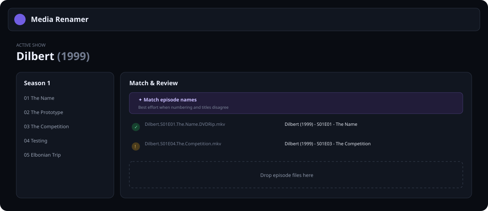

# Media Renamer

A confidence-first desktop renamer for TV episodes, designed as a modern replacement for Rename My TV Series. Movie support is planned on the same metadata and formatting foundation.



## Product principles

- Preview everything; never rename silently.
- Combine episode numbers and title similarity instead of trusting either blindly.
- Make ambiguity visible with confidence scores and alternatives.
- Preserve useful release metadata such as source, resolution, codec, flags, and group.
- Keep metadata providers replaceable. TVDB and TMDB are adapters, not domain models.
- Build renames as a reversible plan with collision checks and an operation log.

## Current foundation

This first scaffold includes:

- an Electron + React + TypeScript desktop shell;
- native file/folder selection and recursive drag-and-drop import;
- immediate ordered display of every imported video, including pending and unmatched files;
- automatic show-name inference from imported episode filenames;
- literal-first title-and-year search with a structured year fallback;
- `S01E02` and `1x02` number matching;
- optional best-effort episode-title matching, including number/title conflicts;
- confidence states (`confident`, `review`, and `unmatched`);
- parsing for BluRay (including standalone `BD` folder tags), WEB-DL, WEBRip, HDTV, DVDRip, TVRip, release group, and common flags, with `ffprobe` detection overriding filename guesses for resolution, video/audio codecs, and channels;
- guarded refresh-all and hover-only per-file refresh actions for re-reading embedded media information;
- parent-folder detection for AI-upscaled releases plus current-batch source and AI-upscale overrides when the filesystem provides incomplete evidence;
- anime-style episode versions such as `S01E01v2` and `S05E10v3`, normalized to the `REPACK` flag;
- editable multiline, Mustache-style output-name templates that produce single-line names with live rename previews;
- portable, byte-safe output names that normalize Windows-forbidden characters and shorten episode titles when necessary while preserving the show name, technical tags, TVDB ID, and extension;
- a non-destructive rename plan with portable filename validation, duplicate-destination detection, live source/target filesystem checks, and JSON export;
- separate persisted TV and Movie library destinations and folder patterns, so each workflow can target its own base folder;
- an optional TV base folder with a templated, Windows-safe show-folder path that rename execution can create before moving files;
- an opt-in move preference that removes each source file's immediate parent folder after a successful move, but only when that folder is empty and never recursively;
- per-file match review with ranked suggestions, full episode search, manual selection, and explicit confirmation before preflight accepts uncertain matches;
- a persisted 50–100% automatic-confirmation threshold, defaulting to 80%;
- complete original/proposed filename inspection through hover, keyboard-focus, pinnable previews, and wrapped Detailed-mode rows;
- companion-file discovery and planning for subtitles, NFO metadata, and named episode artwork, including preserved language/role suffixes and ambiguity blocking;
- active-show poster and preferred English clear-logo artwork from TMDB when available;
- background-worker matching with visible per-file progress;
- a resizable debug console that docks left, right, or bottom, or pops into an independent window, while explaining provider activity, imports, and accepted, review, or rejected match decisions; and
- unit tests for the matching and release-tag core.

The UI uses TMDB for search, artwork, movies, and show cross-references. TV shows use TVDB's English aired-order episode numbers and titles for Plex-oriented sorting. Disabled metadata-agent selectors in each Preferences tab reserve the provider boundary for future alternatives.

## Run it

Requires a current Node.js release and `ffprobe` on `PATH` (installed with FFmpeg). Set `FFPROBE_PATH` when the executable lives elsewhere.

```bash
npm install
cp .env.example .env
npm run dev
```

`npm run dev:electron` is also available as an explicit alias for the complete desktop development stack. Both commands compile the Electron main/preload code, start Vite, and launch the app. Changes under `electron/` automatically recompile and restart Electron so the renderer and preload bridge cannot drift out of sync.

Add a TMDB v4 API Read Access Token and TVDB v4 API key to `.env` before starting the app:

```dotenv
TMDB_ACCESS_TOKEN=your_long_read_access_token_here
TVDB_API_KEY=your_tvdb_v4_api_key_here
# Only required for subscriber-supported TVDB keys:
TVDB_SUBSCRIBER_PIN=
```

Create or retrieve the token under your TMDB account's **Settings → API** page. Do not add a `Bearer ` prefix. The token is read only by Electron's main process and is not exposed to the renderer. `.env` is ignored by Git.

Search accepts show names, TMDB IDs such as `tmdb-1396`, and TVDB IDs such as `tvdb-482771`. TVDB IDs are resolved to the corresponding TMDB record for artwork and show details, while episode numbering and names come directly from TVDB.

This product uses the TMDB API but is not endorsed or certified by TMDB.

Run all current checks:

```bash
npm run check
```

## Matching model

Every imported file is ranked against the selected show's episodes. Evidence is additive:

1. Extract explicit season/episode numbers.
2. Normalize filename and episode titles (case, punctuation, diacritics, stop words, and release noise).
3. Score title coverage with a high recall bias because filenames contain extra show and release tokens.
4. Surface contradictions—such as `S02E07` containing the exact title of episode 8—as review items instead of hiding the decision.
5. Automatically accept matches at or above the configured confidence threshold (80% by default), and require confirmation below it.

Future matching evidence can include duration, air date, embedded title, adjacent-file ordering, absolute/anime numbering, and multi-episode ranges. Provider ordering is metadata, not ground truth.

## Filename templates

Episode names use a Mustache-style template that can be laid out and indented like a script while always producing a single-line filename. After rendering, every run of whitespace becomes one space and leading or trailing whitespace is removed. Other text outside `{{…}}` is literal, so brackets and parentheses need no escaping. `{{#value}}…{{/value}}` includes optional content when a value exists; an `episodes` section repeats for every episode in a merged file. The built-in format is:

```text
{{show.name}}{{#show.year}} ({{show.year}}){{/show.year}} -
  {{episode.range}} -
  {{#episodes}}{{^first}}, {{/first}}{{title}}{{/episodes}}{{#technical}} [{{technical}}]{{/technical}}{{#show.tvdbId}} {tvdb-{{show.tvdbId}}}{{/show.tvdbId}}
```

The syntax-highlighted editor lives in the right-side Preferences drawer, shows a two-episode output immediately, and reports incomplete, mismatched, or unknown tags without breaking rename previews. A collapsible reference alongside it documents every available variable and the variable, section, and inverted-section syntax. Templates are retained locally between launches. The default appends the show's canonical TVDB ID as `{tvdb-74550}` when TMDB supplies that cross-reference.

The main batch toolbar includes a `Move files` / `In place` control. Moving uses the configured TV destination and show-folder template; in-place mode renames each video and its companion files inside their current directories. This is intentionally a current-batch flag and resets when the batch is cleared.

## Delivery plan

### Milestone 1 — useful TV renamer

- [x] TMDB TV search/details/episode adapter
- [x] TVDB English aired-order episode adapter and metadata-agent boundary
- local metadata cache
- [x] whole-show episode browser grouped by season, and file import
- [x] candidate alternatives and manual rematching
- [x] configurable name templates with live examples
- [x] preflight collision/invalid-character checks
- atomic rename/move plan, JSON log, and undo

### Milestone 2 — resilient matching and tags

- [x] video/audio stream detection through `ffprobe`
- duration evidence through `ffprobe`
- multi-episode, specials, absolute ordering, and anime filename patterns
- editable release-tag vocabulary and aliases
- folder parsing, per-show rules, and saved matching decisions
- [x] companion-file planning for subtitles, NFO metadata, and episode artwork
- [x] JSON dry-run export
- NFO export

### Milestone 3 — movies and packaging

- movie search/import workflow using the same provider and tag interfaces
- editions, cuts, collections, and year/runtime disambiguation
- signed macOS/Windows/Linux builds and update channel

## Architecture boundary

```text
Renderer (React)
  -> use cases: search, import, match, preview, execute, undo
    -> domain: MediaItem, Episode, ReleaseTags, MatchCandidate, RenamePlan
      -> adapters: TMDB / TVDB / cache / ffprobe / filesystem
Electron preload exposes a deliberately small IPC surface to the renderer.
```

Provider responses should be normalized immediately. API keys stay in the main process, paths are validated before filesystem operations, and renderer code never receives unrestricted Node access.

## Next implementation slice

Add companion-file planning for subtitles and other sidecars, then execute validated plans with operation logging and undo before enabling the final Rename button. Preview-only UI remains intentional until those safety rails exist.
