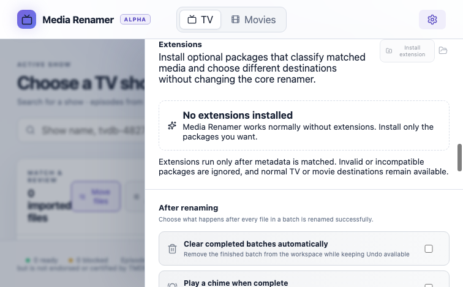

# Media Renamer extensions

Extensions are optional packages that add classification, badges, settings, and destination routing without becoming part of Media Renamer itself. A normal installation works with no extensions. Users choose what to install and every extension starts disabled.

See the ordered [extension development roadmap](ROADMAP.md) for planned metadata, matching, quality-control, automation, and integration capabilities.


## Install an extension

1. Open **Preferences → Extensions**.
2. Select **Install extension**.
3. Choose a package directory containing `media-renamer-extension.json`.
4. Review the installed name, version, source, and requested settings.
5. Enable the extension and configure its destination folders.



Media Renamer validates the package and copies it into its user-data `extensions` directory. **Open extensions folder** opens that exact directory. Removing an installed extension deletes only its copied package and its saved preferences; it never deletes media.

There are three package sources:

| Source | Location | Purpose | Removed in app |
| --- | --- | --- | --- |
| Installed | `<Electron userData>/extensions/<extension-id>` | Packages installed by the user | Yes |
| Preinstalled | Packaged app resources under `extensions/` | Optional organization-managed packages | No |
| Development | `extensions-dev/`, or `MEDIA_RENAMER_DEV_EXTENSIONS` | Run local packages without copying them | No |

Later sources override an earlier package with the same ID. This lets a development package replace a preinstalled version while testing. Development discovery is disabled in packaged builds.

## Create an extension step by step

### 1. Create a package directory

```text
my-extension/
└── media-renamer-extension.json
```

Packages are limited to 200 regular files and 10 MiB. Symbolic links are rejected.

### 2. Add a manifest

```json
{
  "apiVersion": 1,
  "id": "example.animation-libraries",
  "name": "Animation libraries",
  "version": "1.0.0",
  "description": "Routes selected animated media to dedicated libraries.",
  "settings": [
    {
      "key": "showBaseFolder",
      "type": "directory",
      "label": "Animated shows folder",
      "description": "Destination for matching shows.",
      "pickerKind": "TV"
    }
  ],
  "match": { "genreIds": [16] },
  "anyOf": [
    { "originalLanguages": ["ja"] },
    { "originCountries": ["JP"] }
  ],
  "badges": [{ "label": "Anime" }],
  "destinations": {
    "show": { "settingKey": "showBaseFolder", "label": "Anime show" }
  },
  "mediaSettingsTabs": [
    {
      "id": "anime-shows",
      "label": "Anime Shows",
      "mediaKind": "show",
      "note": "These settings apply to anime detected in the Shows sorting page.",
      "baseFolderSettingKey": "showBaseFolder",
      "folderTemplateSettingKey": "showFolderTemplate",
      "fileTemplateSettingKey": "episodeTemplate"
    }
  ]
}
```

### 3. Understand matching

- Conditions inside `match` are all required.
- When `anyOf` is present, at least one of its clauses must also match.
- Conditions inside one clause are all required.
- `genreIds` are provider genre IDs.
- `originalLanguages` use two- or three-letter language codes.
- `originCountries` use two-letter country codes.
- Technical clauses may use `resolutions`, `sources`, `videoCodecs`, `audioCodecs`, `channels`, `audioLanguages`, `flags`, `releaseGroups`, and `editions`.
- `mediaKinds` restricts a clause to `show`, `movie`, or both.
- Technical string comparisons are case-insensitive exact matches. Audio languages may use the detected full name, three-letter code, or two-letter code.
- Matching runs only after trusted provider metadata has been selected.

The example means: genre 16 **and** either Japanese original language **or** Japanese origin country.

### 4. Add settings, badges, and destinations

`settings` currently supports host-rendered `directory` controls. A destination references a declared setting by key. `show` and `movie` destinations are independent. `badges` are displayed on matching media rows only while the extension is enabled and may use `neutral`, `info`, `success`, `warning`, or `danger` semantic tones. `warnings` use `info`, `warning`, or `danger`; they are informational and cannot block a rename.

`mediaSettingsTabs` adds a Preferences tab beside Shows and Movies. Its base folder, folder template, and filename template inherit live from the declared `mediaKind` until the user edits that field. Only customized values are stored; clearing an override resumes inheritance. The base-folder key must reference a declared directory setting, while the two template keys become extension-owned preference values.

A tab may declare `defaultFolderTemplate` and `defaultFileTemplate`. These become editable extension defaults instead of inheriting the main media template. Clearing a user override returns to the extension default. Templates still run entirely through Media Renamer's validated formatter and filesystem-safety rules.

### 5. Run it during development

Put the package in:

```text
extensions-dev/my-extension/media-renamer-extension.json
```

Then run:

```bash
npm run dev
```

For packages stored elsewhere, set a path list using the operating system path separator:

```bash
MEDIA_RENAMER_DEV_EXTENSIONS=/absolute/path/to/packages npm run dev
```

The path may point at one package or a directory containing several package directories.

### 6. Test the installed flow

Run the app, use **Install extension**, select the package directory, enable it, choose its folders, and verify the badge and planned destination before renaming. Run the complete project gate before distributing a package:

```bash
npm run check
```

## Manifest reference

| Field | Required | Meaning |
| --- | --- | --- |
| `apiVersion` | Yes | Must be `1` |
| `id` | Yes | Stable dotted ID containing letters, numbers, dots, or hyphens |
| `name` | Yes | User-facing package name |
| `version` | Yes | Package version shown in Preferences |
| `description` | Yes | Short explanation shown before enablement |
| `settings` | Yes | Host-rendered settings; may be empty |
| `match` | Yes | Required metadata clause |
| `anyOf` | No | Alternative additional clauses |
| `badges` | No | Labels displayed on matching rows |
| `warnings` | No | Informational host-rendered messages for matching rows |
| `destinations` | No | Show/movie routing via declared directory settings |
| `mediaSettingsTabs` | No | Host-rendered media configuration tabs with inherited values |
| `capabilities` | No | Privileged host capabilities requested by the package; every capability remains denied until the user grants it |

Unknown, malformed, oversized, or incompatible packages are ignored during discovery. They remain on disk so their author can repair them.

## Host API and commands

Version 1 deliberately exposes a small declarative API:

| Command/capability | Direction | Effect |
| --- | --- | --- |
| `match` | Extension → host | Describes normalized metadata to match; it does not execute code |
| `anyOf` | Extension → host | Adds alternative matching clauses |
| `badges` | Extension → host | Requests host-rendered informational labels |
| `settings` | Extension → host | Requests host-rendered directory pickers |
| `destinations.show` | Extension → host | Selects an enabled extension's show library root |
| `destinations.movie` | Extension → host | Selects an enabled extension's movie library root |

Packages may declare the `network.metadata` capability with a user-facing reason and an exact list of HTTPS origins. Preferences show each request separately and keep it denied until the user explicitly grants it. Installing or enabling an extension does not grant it automatically.

The main-process metadata network broker is implemented as an internal security foundation. It accepts only bounded GET/POST JSON requests to granted origins, resolves and rejects local/private addresses, revalidates redirects, enforces response and request size limits, applies timeouts and per-extension rate limits, and never accepts extension-provided headers. It is deliberately **not exposed to extensions yet**: production exposure waits for a transport that pins the validated DNS result, preventing a provider from changing its address between validation and connection.

There is currently **no command for arbitrary JavaScript, shell commands, direct filesystem access, raw Electron IPC, silent rename execution, or arbitrary network proxying**. Installation does not grant any of those abilities.

## Secure external command API design

External commands and code-capable extensions will be added only through a mediated host broker. The security contract is:

1. Off by default, with an explicit user setting to enable the local API.
2. Local machine transport only by default; no wildcard network listener.
3. A randomly generated, revocable credential stored outside extension packages.
4. Versioned JSON messages with strict schemas, size limits, timeouts, replay protection, and rate limits.
5. Explicit capabilities in the manifest, approved by the user per extension.
6. Read-only capabilities separated from state-changing commands.
7. State-changing commands produce a visible preview and require confirmation unless the user creates a narrowly scoped rule.
8. Paths are canonicalized and constrained to user-approved roots. Extensions never receive unrestricted path access.
9. The main process owns all privileged work. The renderer and extensions never receive Electron primitives.
10. Every request and decision is auditable without recording media contents or secrets.

Planned broker commands include `media.inspect-summary`, `batch.add`, `batch.preview`, and `extension.status`. Commands such as `batch.execute`, filesystem mutation, shell execution, and arbitrary network proxying are not granted by default. The broker is not exposed until authentication, consent, revocation, and audit behavior are implemented and tested together.

## Why version 1 is secure

- Manifests are data, not executable code.
- All input is parsed and normalized in Electron's main process.
- IDs, text lengths, arrays, language/country codes, setting references, package size, and file count are bounded.
- Symlinks are rejected during installation.
- The host renders all UI and owns every destination decision.
- Privileged capabilities are independently declared, validated, displayed, and denied by default.
- Metadata network requests pass through a bounded host broker; extensions never receive raw network primitives.
- Extensions cannot bypass rename planning, collision handling, preflight checks, operation logs, or undo.
- Disabling or removing a package restores the normal core behavior.

The development Anime package in [`extensions-dev/anime`](../extensions-dev/anime/) is the complete working example.
